# Beam

Archived from <https://www.joshiankit.com/work/beam/> on 2026-10-15 (static HTML, no scripts run).

## Beam

You're there!

This is a crazy one! a concept designed and built around the idea of teleportation. Yes! you read it right. The idea may seem fictional (for now) but design challenges can be real and can easily fit more of a real use case.

### Challenge

When you can go anywhere, the ease of discovering from a world map down to picking a precise landmark can be one of the main navigational challenge.

### Things to consider
Teleportation as a concept sounds simple, go anywhere instantly, but it does come with a set of challenges.

Privacy
You cannot just drop in anywhere, depending on the place you may need anywhere from authorized access, paid membership, permission or simply a heads up. These fundamentals checks are in place to ensure our privacy and security of the people.

Safety
The freedom to drop anywhere also comes with a responsibility of ensuring everyone's safety. Roads, hyperloop tubes, construction site, assembly lines etc. are few of the examples of where you may be prevented to beam at, purely for safety reasons.

Access
Considering the two constraints above, famous landmarks and other public places would be the easiest to get to. And given you may be going to a completely new place, some kind of real 'peek' at that place can definitely help.

Interaction
This tech has to potential to drop you anywhere within seconds. So its key to make sure the interaction is explicit and intended. This is a point where a little bit of friction is good thing, because an acccidental interaction can mean you're somewhere in the world.

### The needs and requirements

### I wanted to nail down some of the core features and functionality, that can serve as a minimum viable product for this concept.

### Favorites: These can be some of the frequent places you visit and would like quick access to.

### Recents: This is natural behaviour even today, you start directions to your destination found in your recent history.

### Explore: Discover new places to go and just be(am) there in seconds.

### Settings: Configure your app, access points and manage your preferences regarding your teleportation.

### Profile: Your profile is your identity, it also contains all your credentials and memberships which can dictate the places you're authorized to go and the places you're not.

### Search: This can be a powerful tool in discovering new places or just pull up old ones from your history. It can also surface necessary determining information about the place to help the decision.

### Take me home: No matter where you go, there's nothing quite like home. I feel like a quick shortcut to home warrants a prominent place in UI.

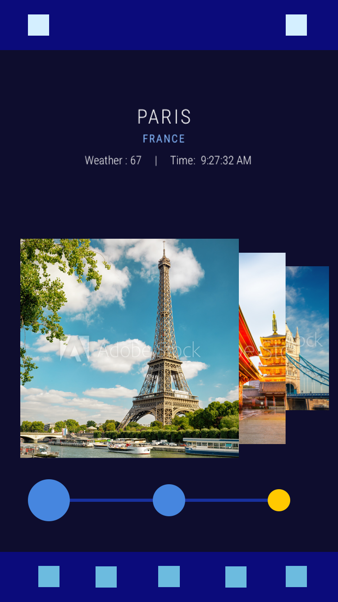

### Doodles in Adobe Comp CC

### I started toying around with this initial idea, I had floating in my head. It was pretty narrow for the scope of the app could be, but I still wanted to explore to a point where it broke as a viable option.

### I was about to board a red-eye to east coast and I wanted to quickly sketch this idea out. I didn't have a pen and paper but,fortunately, I had Adobe Comp CC, something I had never used before but had heard great things about.

### 20-30 min in to the exploration it gave me a fair idea of the UI and the interactions it'd need. The idea was from a world view a user can zoom in on a precise landmark by tapping on country, city cards and landmark displayed as a carousel. The slider can act as an alternative way to navigate back and forth too.

### Quick Inspiration

### One of the key challenge was to allow user to go from god's eye view to first person in a very smooth fashion. So I turned to mapping and transportation apps for inspiration. As this concept is a mix of both.

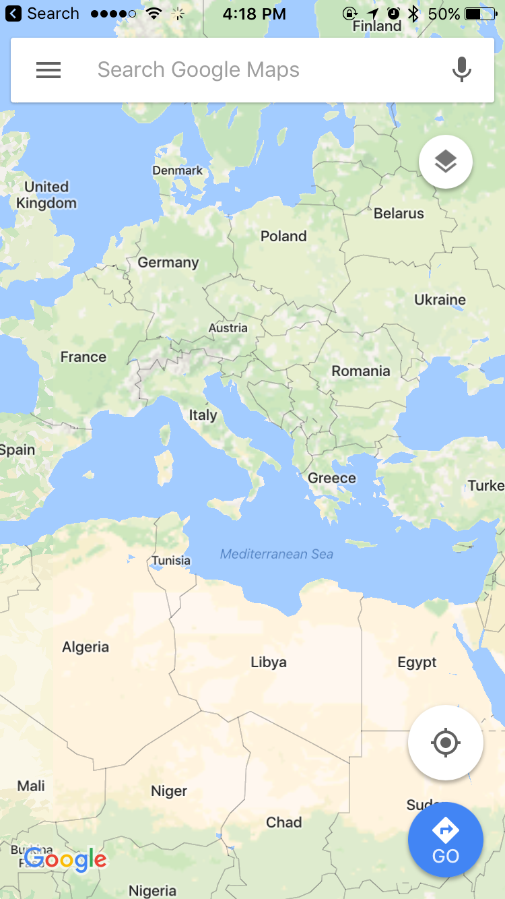

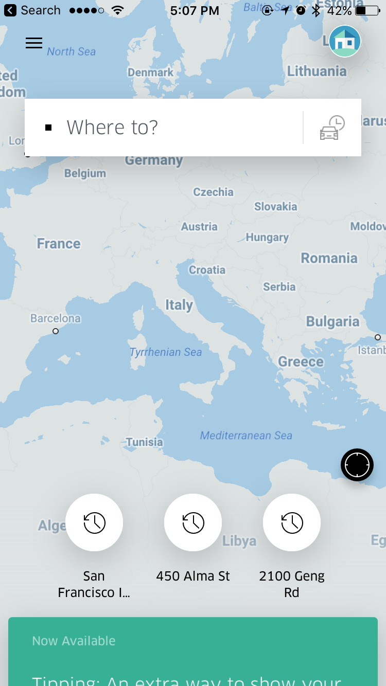

### Get beamed

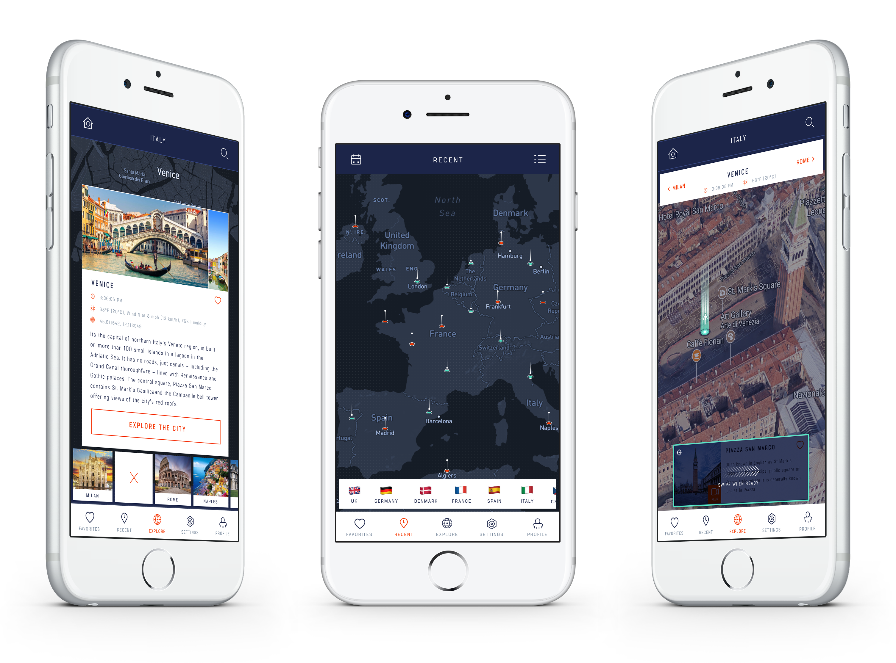

### Favorite places in the world

This can be short and personal list of places you'd like to go to.

Address Book: There's also an address book option in the favorites tab to access all your phone's contacts and add them to your favorites.

Access: Some of your favorite may still require you to notify them before you can beam there, or may be a paid membership in some cases. The favorites card will surface such information and will allow you to handle it right on the card itself. For e.g Give a ring to nick before you go.

Tap & Swipe away: This is one of the key interaction within the app. To go anywhere, you need to tap that location card to set/lock the destination and when you're ready to go just swipe the card away and you're there. This way its an explicitly intended action and can reduce accidental beams.

Key Information: The card also surfaces some key information about the destination like time, weather and the city. This can be helpful in deciding where to go and when.

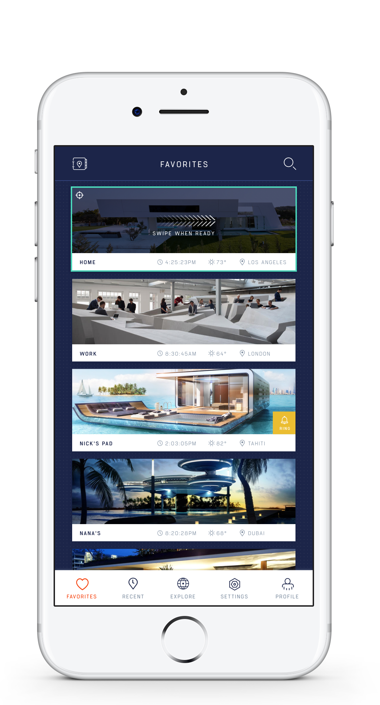

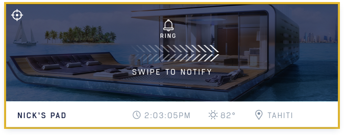

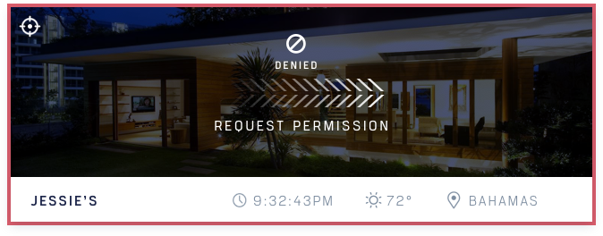

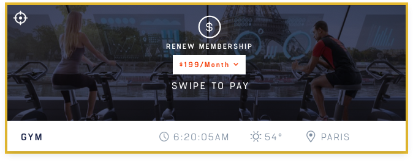

### Recent

### You easily checkout the places you visited last with recent history. Filter recent with time filter or use calendar to see past visits as well. Jump to the map view to look at interactive view of where you've been. It also highlights all the incoming (green) and outgoing (red) locations with color coded geo markers. You can pinch and zoom in to find the precise location

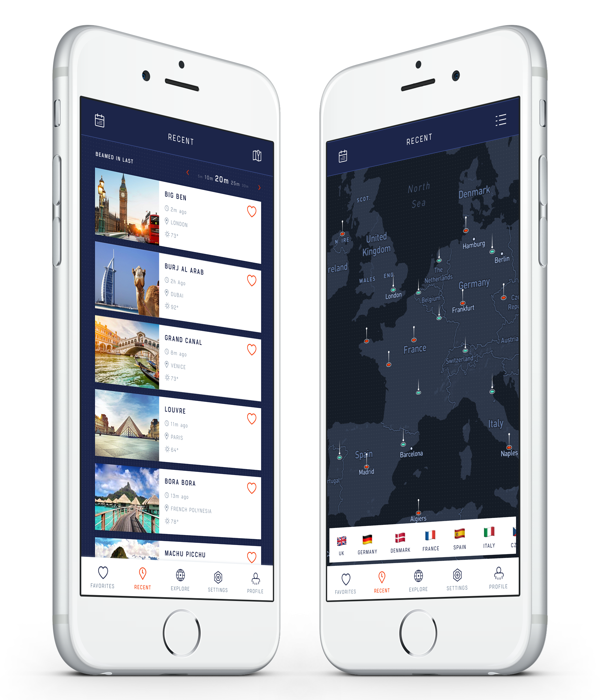

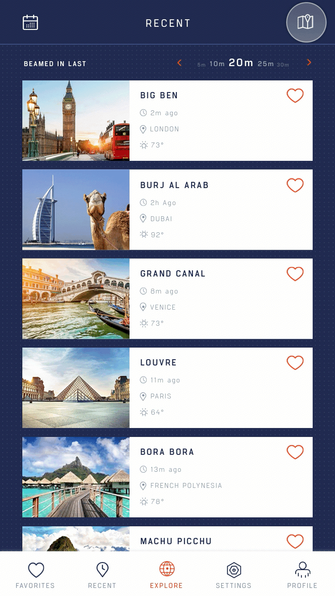

### Be anywhere

Zoom in: 
Go anywhere by starting with a world map and with a simple pinch and zoom be exactly where you want to be. The app will display apt information based on the level of your zoom, starting from country all the way to a famous landmark in a city. This can quick if you know where you want to be.

Drill down: 
Alternatively, you can explore by panning the map around and the app will display countries that are currently in the map view. This way you can easily start by picking a country and then hone in on a new place.

Take me home: 
A quick shortcut to your home is always available anytime you're exploring. So you are always a tap and a swipe away from a comfortable place.

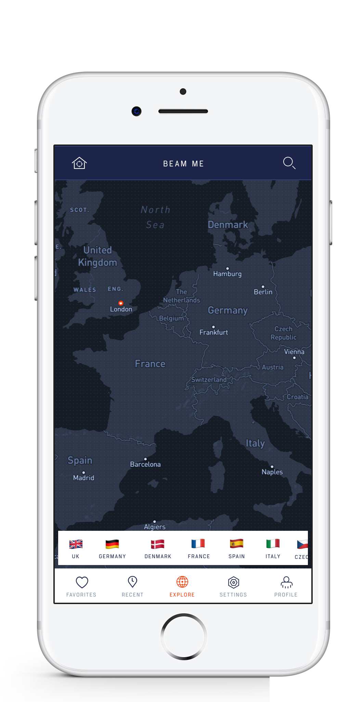

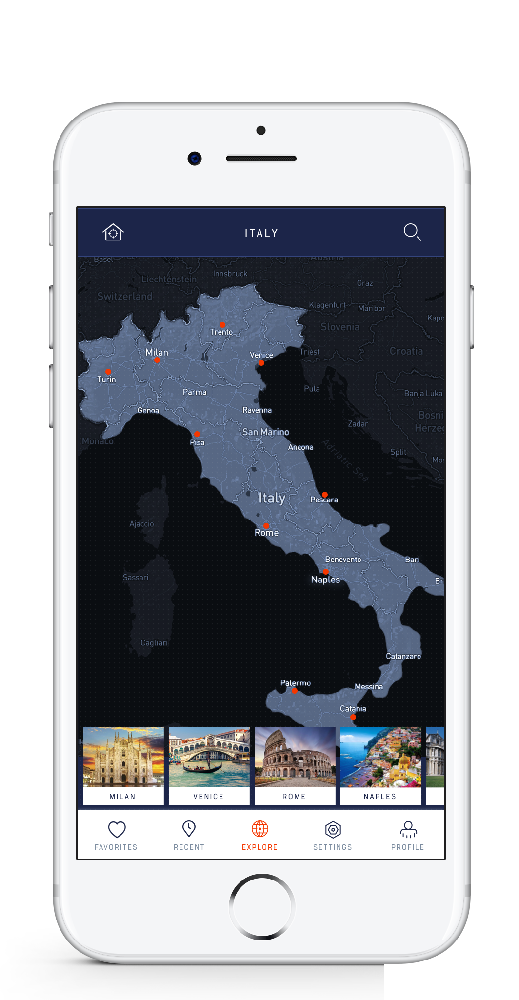

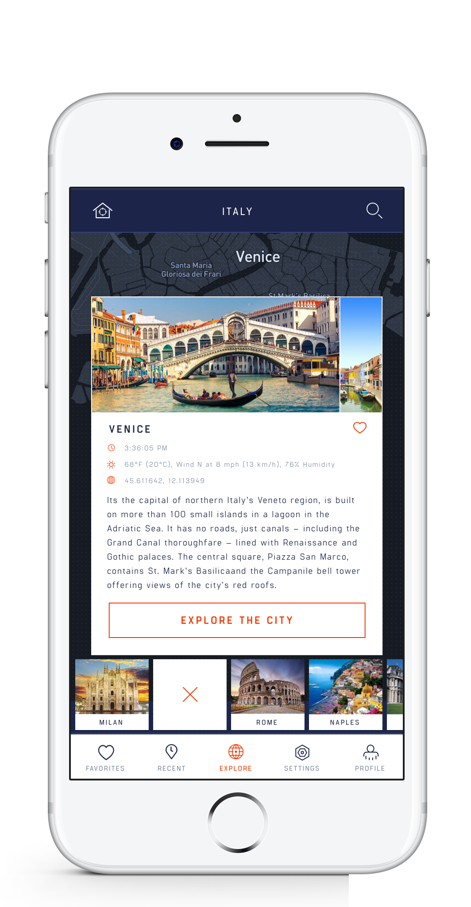

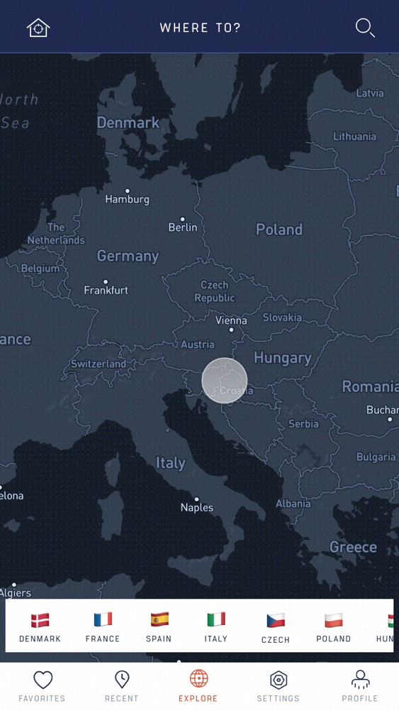

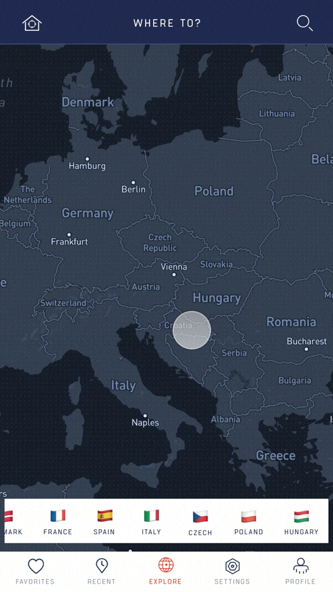

### Pick a landmark

### When you find the perfect city to explore, then simply pick a landmark or point of interest to beam yourself to. You can adjust your position by simply panning the map.

### Peek: If you are not feeling adventurous, then you can always 'peek' at the location before to go. This will give you a 360° live view of the location of your choice.

Satellite View: You can also get a real view of the city or location to get a clear undertanding of where you're going to be.

Once ready just set the location you want to go to and swipe when ready to be beamed there.

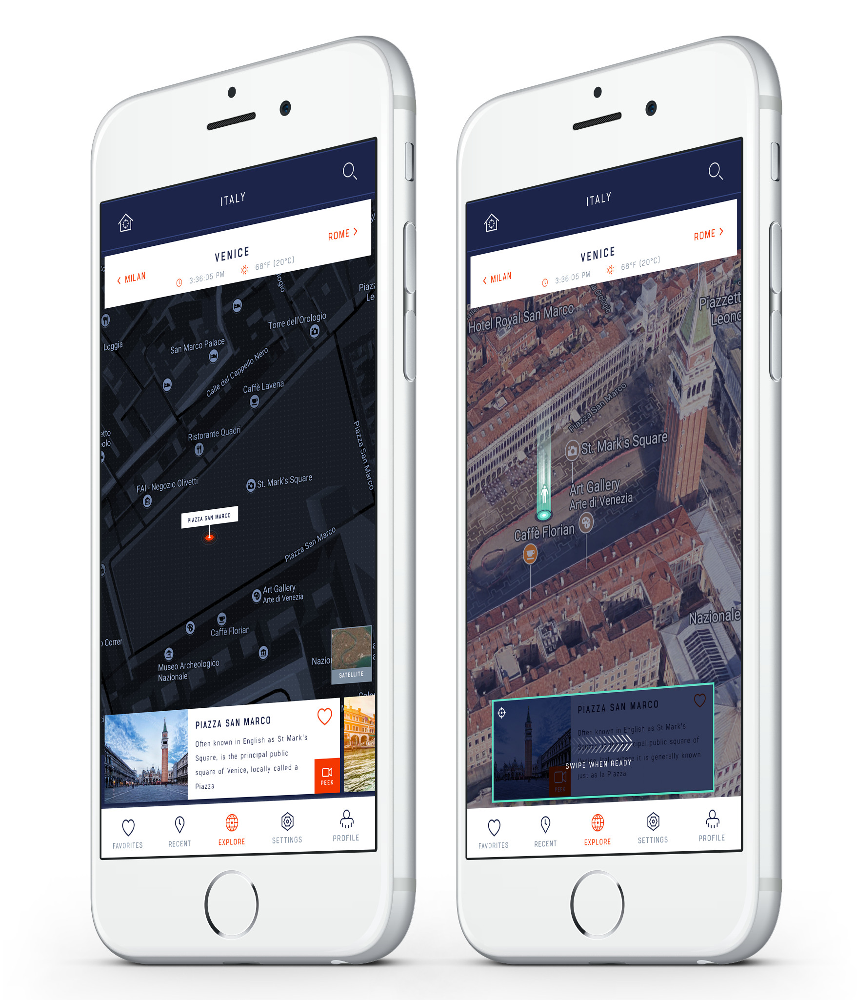

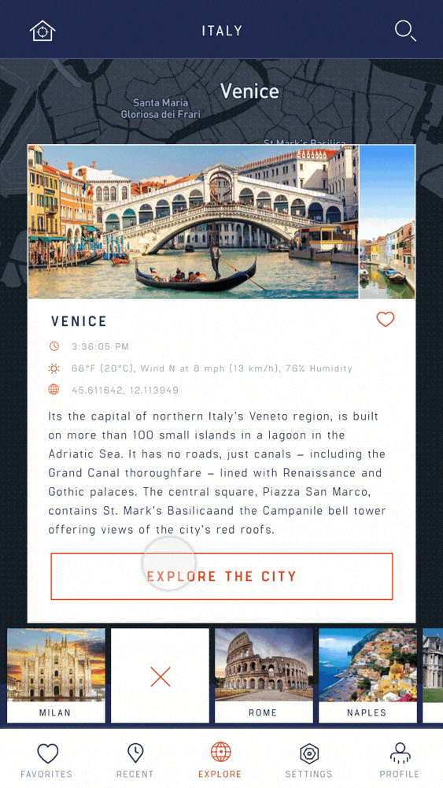

If you are reading this, it is because your browser does not support the HTML5 video element.

### Thoughts

### This tech may or may not make it in the real world, but its fun to stretch design muscles and prepare for the unforeseen challenges that are still to come. This may work as MVP for this concept, but it can be refined with multiple iterations. But I believe some of the key interactions that are strong core of this design concept can be great framework to build future features on and scale this product

Related

Work

CloudOn Tablet
____

Recipes
__

Beam
–––

Houzz
--

CloudOn Mobile
____

Concept
—

Smart Hotel
___

CloudOn Web
____

415 244 2442

LinkedIn

Résumé

Dribbble

Twitter

Facebook

Instagram

Related
