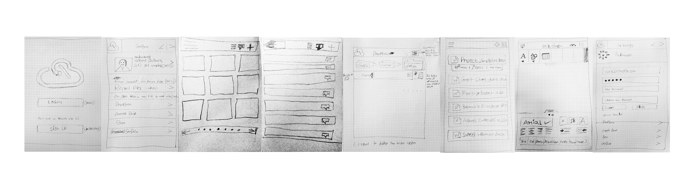
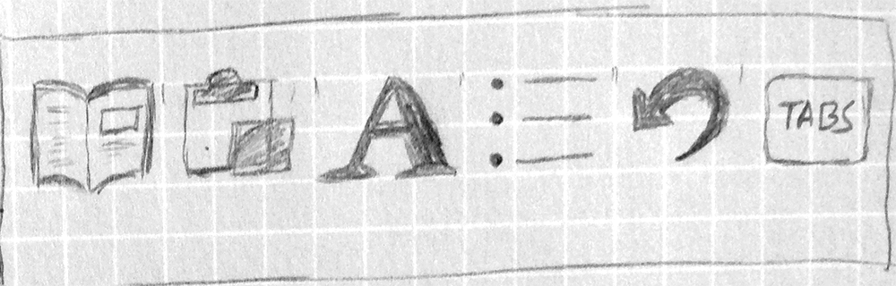
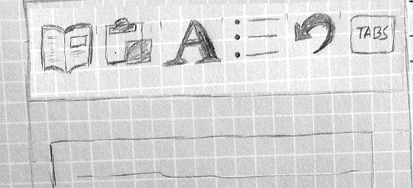
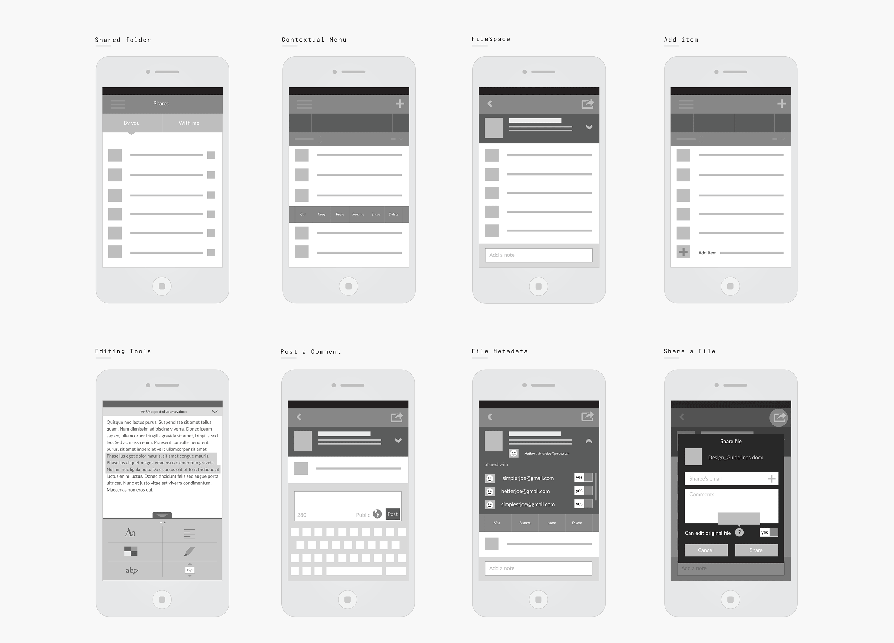
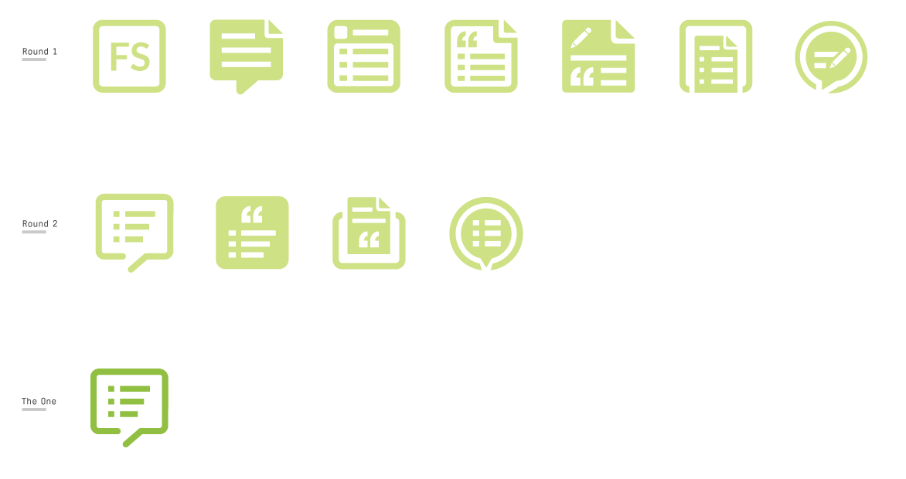
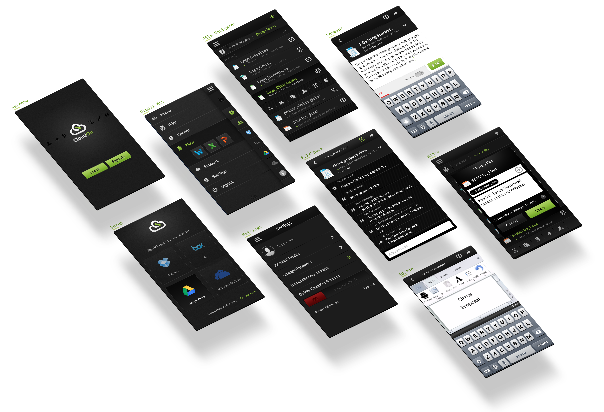
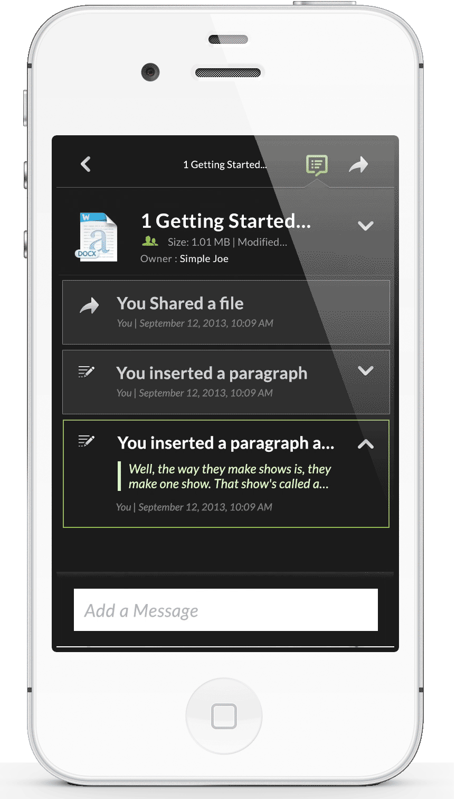

# CloudOn Mobile

Archived from <https://www.joshiankit.com/work/cloudon-mobile/> on 2026-10-15 (static HTML, no scripts run).

## CloudOn
Mobile

Content collaboration on-the-go

CloudOn (acquired by Dropbox) was productivity app. We use to 'stream' Microsoft office on iOS. We were streaming office from a virtual server and mapping the touch gestures to mouse events (yikes!), calibrating in milliseconds, and multiple backend handshakes later a user could edit a doc on the go. Yes, there was some lag, but the value prop was much higher and the users were willing to live with it. To deal with that we created something called 'Filespace) where you can collaborate with your peers and perform some light actions on the go.

Lead Designer
2012

### Trying to

Evolve the design language on a mobile client, while boiling down a tablet product on to the new medium. It was the vehicle to drive the design forward before it was rolled out on the flagship tablet product.

### But the challenge was

A critical feature called 'FileSpace'. A northstar for the mission of collaboration and mobile productivity. This meant altering the user flow to guide users to filespace before even opening the file. Navigation had to be rethought along with the UI to feature this key piece. It was all about FileSpace. 
But the real challenge was to make the experience between file editor and FileSpace seamless.

### Pencil and Paper

Sketched some of the key pieces of the experience with some new UI exploration to fit in filespace feature set. Strived to maintain the usual flow as much as possible. Blankness of a canvas can sometimes spark some good ideas, paper is that medium.

-

Explored a grid view and a list view for the file manager, as it can be easier to tap a box vs a row. But then again, for us, we could fit more content and information in a row vs a box.

-

Breadcrumb needed to rethought as it can easily turn in to 'folderception' with a tree structure. Sketched a more visual way to navigate.

-

File Editor was the hairiest problem of all. We were limited by the customization we could do and even the limited amount of features of MS office on tiny screen was tall order for the UI. Had to get creative and break features into a more contextual scenarios.

### Paper Prototype?

Got a few ideas while sketching and decide to quickly prototype to run it by the stakeholders about the feasibility of the concept

### Wires

The focus was mainly on the structural and navigational integrity. I made sure we had a good foundation that was easily scalable. I decided to included product and engineering at this point to avoid major roadblocks as its cheap to pivot at this point.

### Filespace Identity

Since filespace was a brainchild of cloudon, we needed an identity for filespace. It needed to symbolize content collaboration. I designed few options and put it up on the wiki for everyone to comment on, did two rounds and landed on 'the one' that captured the idea perfectly.

### Interfaces

The visual design kept the mobile within the product family. But the overall design evolved to a clean and a stark experience. It was pretty important for us to achieve a true cross platform ubiquity and the design ensured that user had a seamless experience, no matter the platform.

### FileSpace «-» Editor

I prototyped this interaction to solve the real challenge of FileSpace to file editor and back experience. Based on an strong hypothesis that once a user is here, they're more likely to open the file than not. The use case was there. It should make jumping back and forth pretty seamless. But I wanted to got bit deeper with this interaction than just motion, the real trick was under hood.

- Loading time was a pain when it came to opening the files to edit. So when I designed this interaction, one of the requirement I had proposed was that we start preloading the file as soon as the user comes to the filespace. We can save a lot of time for the user and make the entire experience way more smoother.

- This also took care of the scenario when the user doesn't have the edit access then the file will open in 'Read Only' mode. This interaction was designed so that when the file editor opened, it would drop toggle the share icon in lieu of 'Read-Only' icon. And Revert once the user was back to filespace.

- A caveat, it was a cost for business to run one of the virtual instance, so if the user didn't end up opening the file, we could incur the cost.

Related

Work

CloudOn Tablet
____

Recipes
__

Beam
–––

Houzz
--

CloudOn Mobile
____

Concept
—

Smart Hotel
___

CloudOn Web
____

415 244 2442

LinkedIn

Résumé

Dribbble

Twitter

Facebook

Instagram

Related
