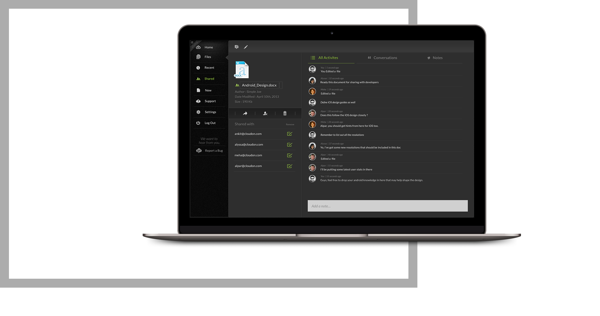
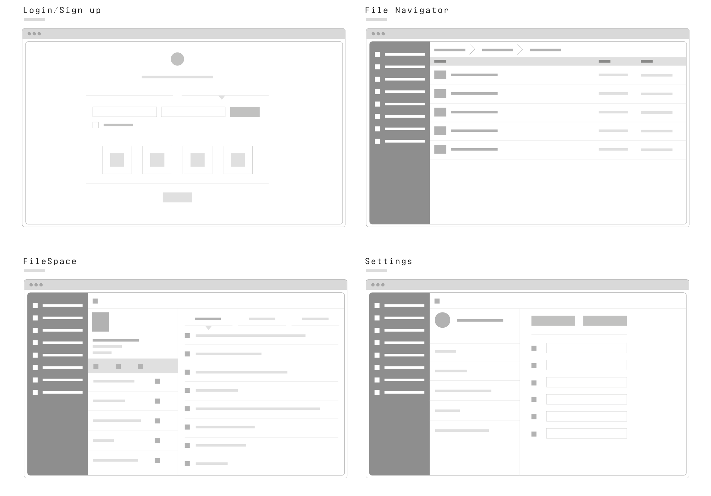
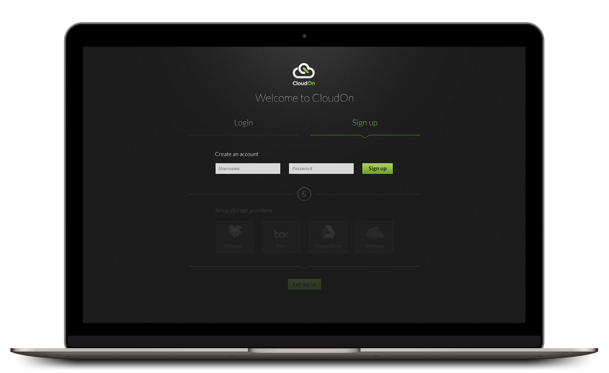
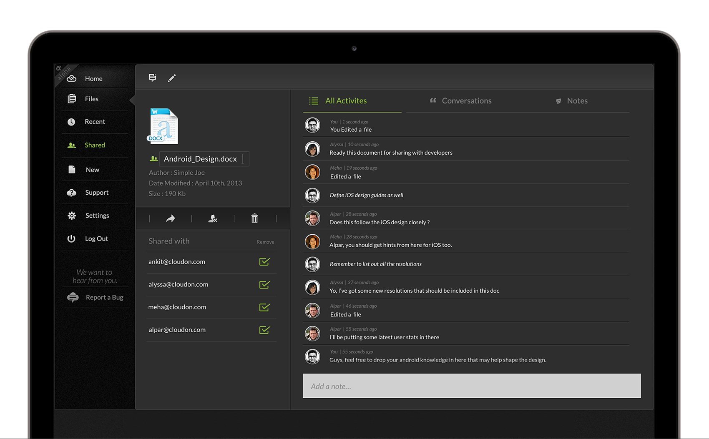
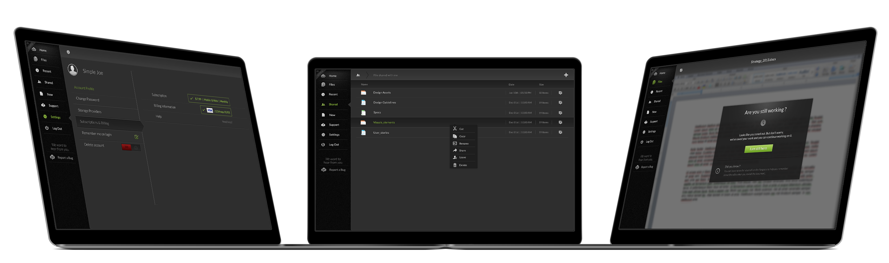
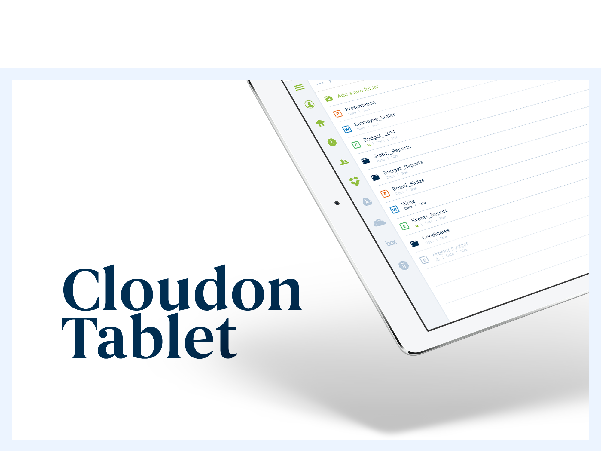
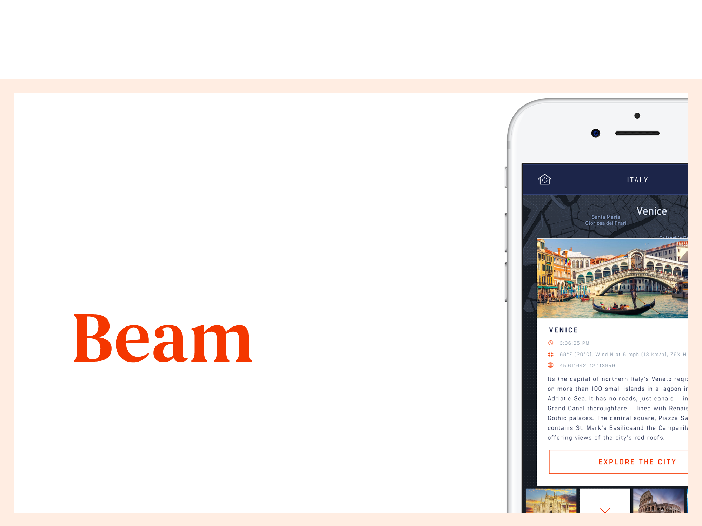

# CloudOn Web

Archived from <https://www.joshiankit.com/work/cloudon-web/> on 2026-10-15 (static HTML, no scripts run).

## CloudOn
Webapp

Powerful productivity

CloudOn (acquired by Dropbox) was productivity app. With the introduction of webapp, we were planning to achieve ubiquitous experience for our users. Webapp was the most powerful client for us. Since it was to be used on a proper machine, desktop/laptop, it'd cater to anyone with or without the mobile apps. We could harness the processing power of laptop and provide the best experience of all the clients we had. It was also going to drive growth by capturing a new set of userbase who preferred laptop for productivity apps vs a mobile client.

Lead Designer
2013

### The Goal

Design parity with mobile was one of the top goal for this. This meant scaling the design up from mobile to web. Translating all the touch interactions and experience to the web medium. I had a bit of real estate shock switching from designing the mobile client.

### Wires

I wanted to nail down few key states and get a nod from the eng & product team for the overall direction. Structurally, there were really a few 'parent' views which contained multiple children views which followed the same UI structure with different content. I wanted to figure those out in wires.

### Simple Sign up

I wanted entry point to be dead simple so I laid out Login and Sign up equally, so that its uber clear. Also made the two step sign up as part of one experience, thanks to the extra real estate. As a result, the whole sign up process felt transparent and quick.

### Progressive FileSpace

Took the progressive design route and introduced more personalization for FileSpace on web. Also, cleaned up organization for different content elements like public comments and personal notes, by separating them under different tabs plus a feed view to get a complete context.

### Some new features

| Subscription in the settings, simply surfaced the status of your subscription and payment method.
| For the File ops actions, I adopted a contextual menu on right click so its easily accessible.
| Timeout, unique to web, was introduced to increase privacy on a potential shared machine.

Conclusion

We were able to launch the webapp to a much a wider audience. The feedback was mostly positive since it was not laggy mostly beacuse was running on a much powerful machine. It also filled a huge userbase gap for people not on mobile. This launch was successful in making cloudon truly ubiqitous. In fact, we started saw some users deserting MS office and adopt cloudon, as it was a cost effective option and was available across multiple platforms.

Related

Work

CloudOn Tablet
____

Recipes
__

Beam
–––

Houzz
--

CloudOn Mobile
____

Concept
—

Smart Hotel
___

CloudOn Web
____

415 244 2442

LinkedIn

Résumé

Dribbble

Twitter

Facebook

Instagram

Related
