# Recipes

Archived from <https://www.joshiankit.com/work/recipes/> on 2026-10-15 (static HTML, no scripts run).

## Recipes

What will you cook today?

An app concept for all the home cooks, wanna-be chefs, foodies, cooking enthusiast and pretty much anyone who has an interest in learning to cook a thing or two. To design a concept around recipe sharing experience and learning to cook with them as easy as possible to encourage more people to join in and share their creations.

### Challenge

Making the learning experience easy and (positive) result driven to encourage more people to share their experience with the rest of the community.

### Researching the industry

I've been through a few good cooking aid apps since I am trying to expand my culinary creativity. Generally, they're decent enough to help one cook with some prior cooking experience. But I wanted to go deeper into this space to understand the underlying patterns of educating people learning to cook. The different approaches all the apps take to serve the same goal of the user. So I started by looking for some of the good apps doing just that.

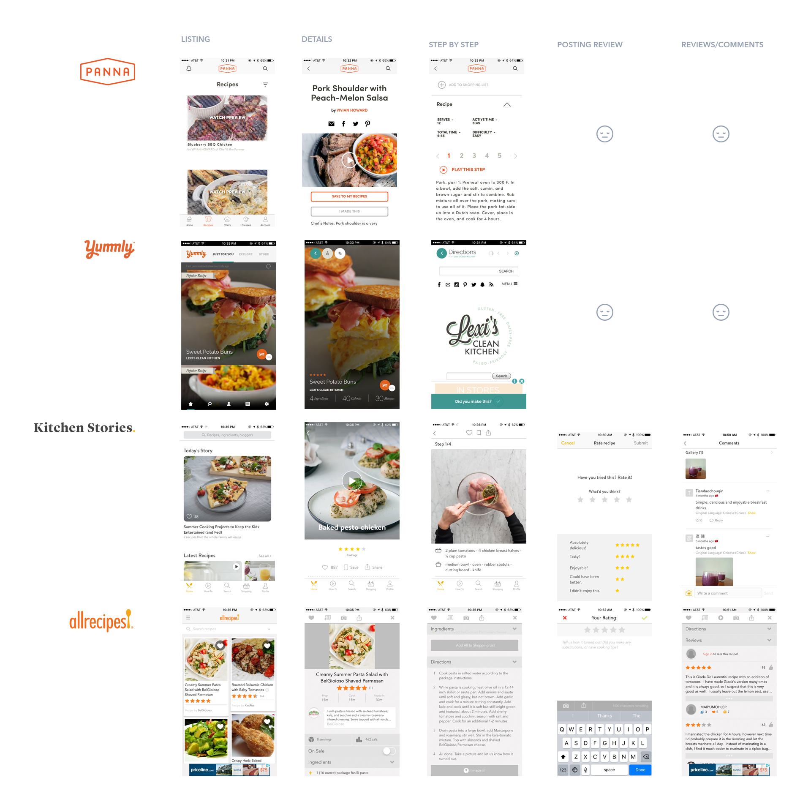

### Breaking it down

### I looked at four products, each has its own special characteristics but I was interested in how are they engaging users and growing the community. Also, how are they spreading the word out and is there a community voice in the product.

### Sharing 
I found that almost of all of them have social sharing as it is the most obvious mechanism to employ to get the word out. Experience differed wildly ranging from limited networks to a native share sheet with as many options as the user has configured on their device. The product which had a custom share dialog felt limited by options and can be an extra step sometimes as you need to connect/grant access to the product. As compared to OS sharing sheet had options that other product couldn't reach.

### Learning: That OS sharing sheet is can be the easiest and best method for social sharing. Cost effective for engineering and reward yielding for product as it can go out multiple channels with minimal configuration on the either end.

### Reviewing 
This can be a good way to keep the content in check through community effort. Off the 4 products I looked into, two of them didn't have any sort of commenting/reviewing of the content. Mostly due to a different business model. The other had review/comments in a limited capacity. The experience of posting a review/comment was very basic, which is key to engage users at first. I found the 'kitchen stories' posting experience much more easy and delightful. It was frictionless as they proactively ask for specific feedback.

### Learning Experience
This was one of the core experience in all the 4 products. The approaches varied from very a well thought out step-by-step video guidance to ensure the users learn the right way and achieve a positive result to very bare bones approach of list of instructions for the user to follow with minimal guidance. From personal experience, I knew a well thought out video can help the user learn quickly and the right way. It also adds layer of interactivity as the chef narrates in his own style. It also has an added bonus of re-watching it multiple times too.

### Watching and learning is always better than reading instructions, especially when you're working.

### Asking a lot of questions

### As part of my process, I am always curious to get raw thoughts from random people on whatever I am researching about. Time was of the essence, so I resorted to one of the best ways to get unfiltered answers, casual chat at the communal lunch table. And the topic was fitting too I was trying to figure out

### If people even use apps to learn how to cook?

### What apps did they think were helpful and why?

### What do they do after they were finished cooking?

### Did they share their feedback or ask questions in the community?

### Did they go through that experience because they had to or want to?

### The answers varied, as it was expected. But there was a pattern in their behaviour. Most of them did rely on and preferred a step-by-step tutorial for their learning needs. When it came to the reviews/comments they were mostly for encouraging them to try something new after reading stories from people with whom they can relate to. One of the interesting i discovered in this conversation was that most of the users who relied on reviews to make their decision were the ones who were motivated to go back and write a review for others.

### Learning: 
Most of the users who read a lot of reviews and comments are more likely to be motivated enough to return and write one for others.

### Doodling around

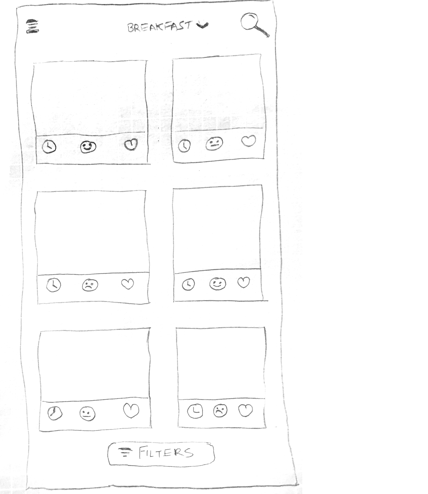

Initial UI aka Braindump
This was one of the earliest sketches, the card based grid affords an opportunity to fit more content. But it had some drawbacks too, the tap target could be an issue, the competing real estate meant a crowded marketplace and lack of focus in general.

I also played around with the idea of floating filter button, as I thought that'd be most used action to quickly find content the user needs.

Details Page

In the early exploration of the details page, I tried giving photos some prominence as media can help the user decide quickly.
The ingredients list was also embedded in the same view, which could make it busier.

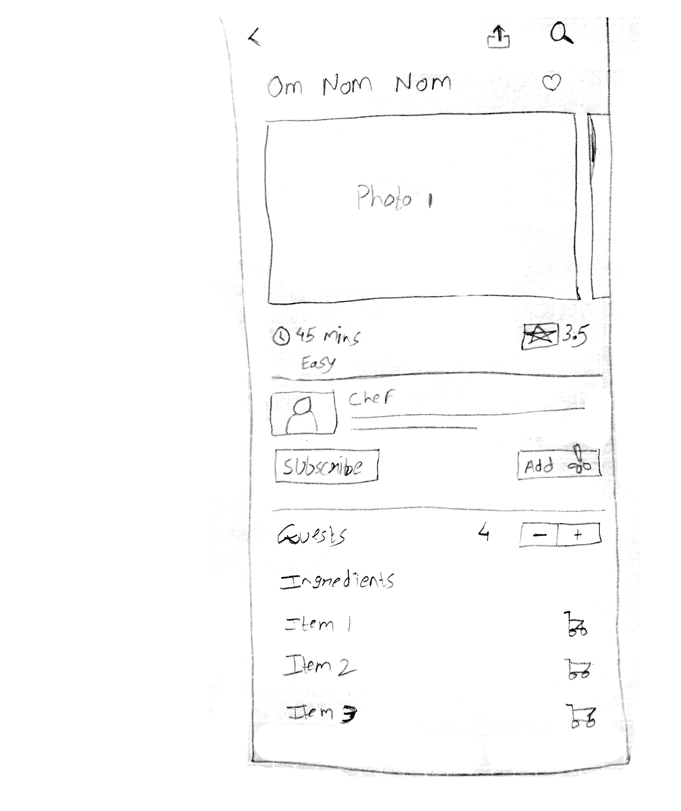

### Enter Yelp Recipes

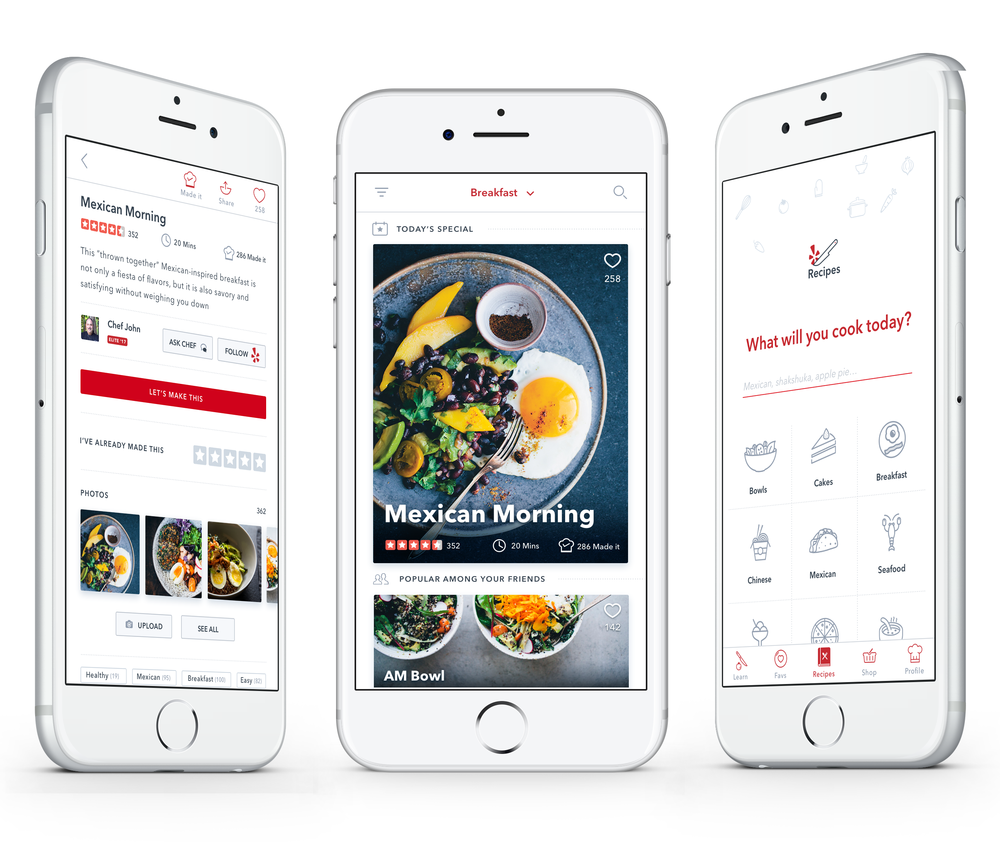

### One simple question

Yelp Recipes provides the answer to that. You can simply start by searching for a specific item or cuisine or just pick the type of food you want to prepare from the categories below. You'll find exactly what you want in no time.
Learn: A place to discover culinary classes from yelp. It also features in app tutorial for some of the basic cooking skills one may need to get started.
Favs: All your favourites recipes categorised and available in one place. You can even share your favorite list with your friends and family as well.
Recipes: This is where the magic happens, you'll be spending a lot of time here, discovering recipes, trying them out, sharing, reviewing and participating in the community. 
Shop: We make it easier to for you to shop for your ingredients while you're planning your next culinary adventure. We also provide yelp delivery option with delivery options as quick as within an hour.
Profile: Well, that's you, your work, reviews, status, comments, preferences and more, in one place.

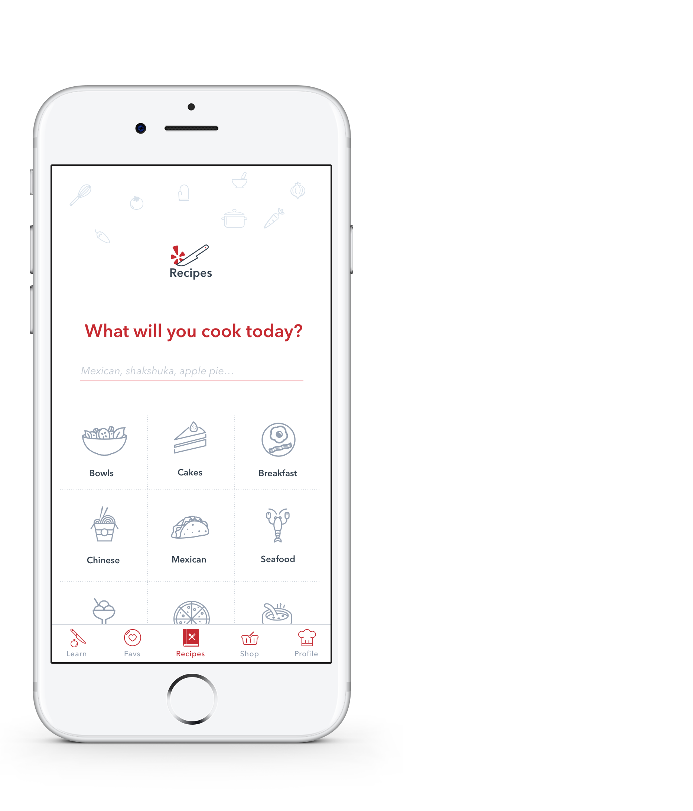

### All the recipes

Yelp's recipe directory is powered by a big community of enthusiasts who exchange, share and review each others culinary creations. The card highlights three key metrics of the recipe's popularity that can help the user decide. Rating, cooking time and how many people actually made it. We also showcase whats popular among user's network, encouraging sharing and reviewing their friend's creation.

Filter: You can always filter down the list by filtering down to your preference, just how you use it to find the right business or restaurant in the parent app. The filters range and options cover every single recipe in the app.

Search: If you have something specific in mind, you can always search by either the name, category or kind of cuisine. Every keystroke will start generating matching results giving you the full transparency and control over your search.

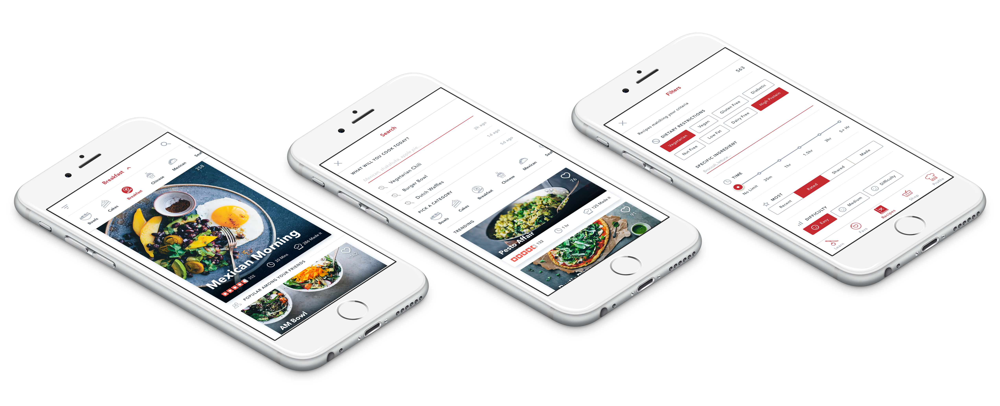

### Recipe Details

The details page was designed to encourage a user to either share and review that recipe or make it.

Status bar: A user can always find 'made it' 'share' and 'fav' up in the status bar, just as in the parent yelp app. This can make sharing much easier.

Recipe Detail: A nice brief description helps user learn more about the recipe and highlighting the author of the recipe provides some additional key information to make the decision forward. If the user is already familiar with the author, then they can either subscribe to their recipes or follow them on the parent yelp app.

The Choice: Since the user is now familiar with the recipe and its author, they can easily decide their next action

• If they've already made this recipe before then all they have to do is to review it. A quick tap on the stars activates a quick review window just like the parent app. I designed the review screen be a motivational and delightful experience(as you can see in the prototype below).

• Or if they feel prepared then they can jump right into making this recipe.

User Reviews: Rest of the page is dedicated to the user reviews. Each review has the author and their credential highlight much like the parent app. Plus their photos are always available inline to either scroll through them or open up the gallery.

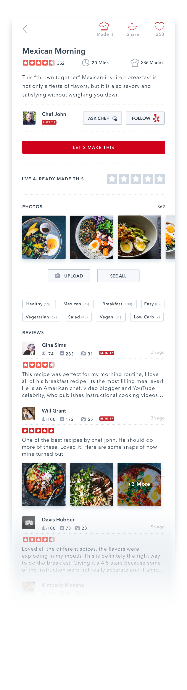

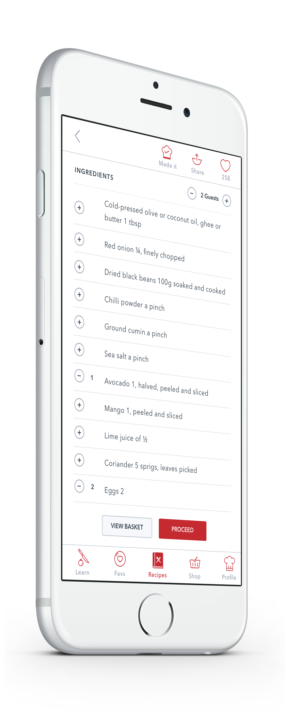

### Shop

### When you're cooking new creations, your pantry needs to be well stocked. That's the idea behind this feature where a user can quickly add an item from the ingredients list and get it delivered by yelp within an hour or two. Just a few taps and your ingredients can be at your doorstep.

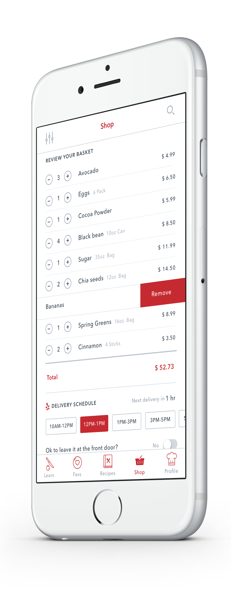

### Command

### Once you start cooking, we simplify the experience and focus on getting you the step-by-step instructions and giving you the control the progress of it. That's why with your permission we can turn on voice controls through which you can verbally control the experience with simple commands like 'Pause' or 'Previous steps'. It can also narrate the text instructions or auto play a video tutorial.

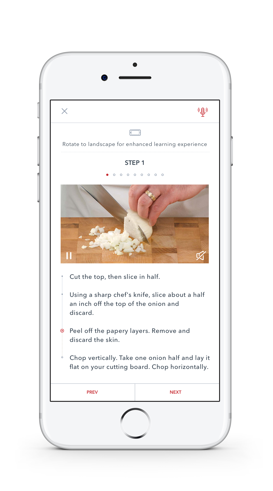

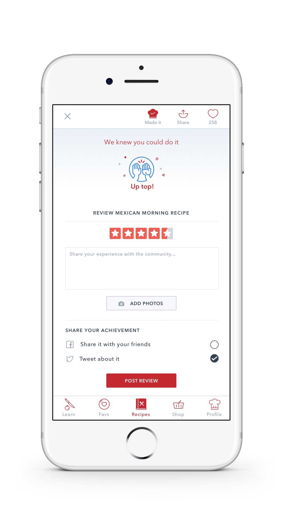

### That's awesome!

### When you're done making your cake (you can have it too), you can simply share your accomplishment by tapping 'made it' and review the recipe, this can help others like you who were not sure whether they can bake a cake or not as well as the author if they can somehow improve the recipe. You can share your few pictures of the cake (if there's any left) and post it on social media. This ensures that the community is always thriving and offer help to one another.

Have a go at it

A quick prototype covering a basic flow.

Embedded media: <https://marvelapp.com/3d40ebd?emb=1>

### Conclusion

I believe the young culinary community can definitely benefit from such a product, where they can truly test out their creations, get validation and/or feedback and improve their skills. While the rest of the community can enjoy the recipes and maybe get ideas to create their own. The platform can help boost the yelp delivery business as well as it can be great place for young food business to shine by interacting directly with the customers. With the right strategy in place this can be great mutual asset between a business and a customer.

### So, what will you cook today?

Related

Work

CloudOn Tablet
____

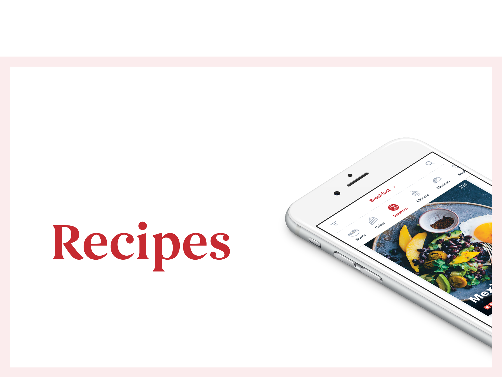

Recipes
__

Beam
–––

Houzz
--

CloudOn Mobile
____

Concept
—

Smart Hotel
___

CloudOn Web
____

415 244 2442

LinkedIn

Résumé

Dribbble

Twitter

Facebook

Instagram

Related
