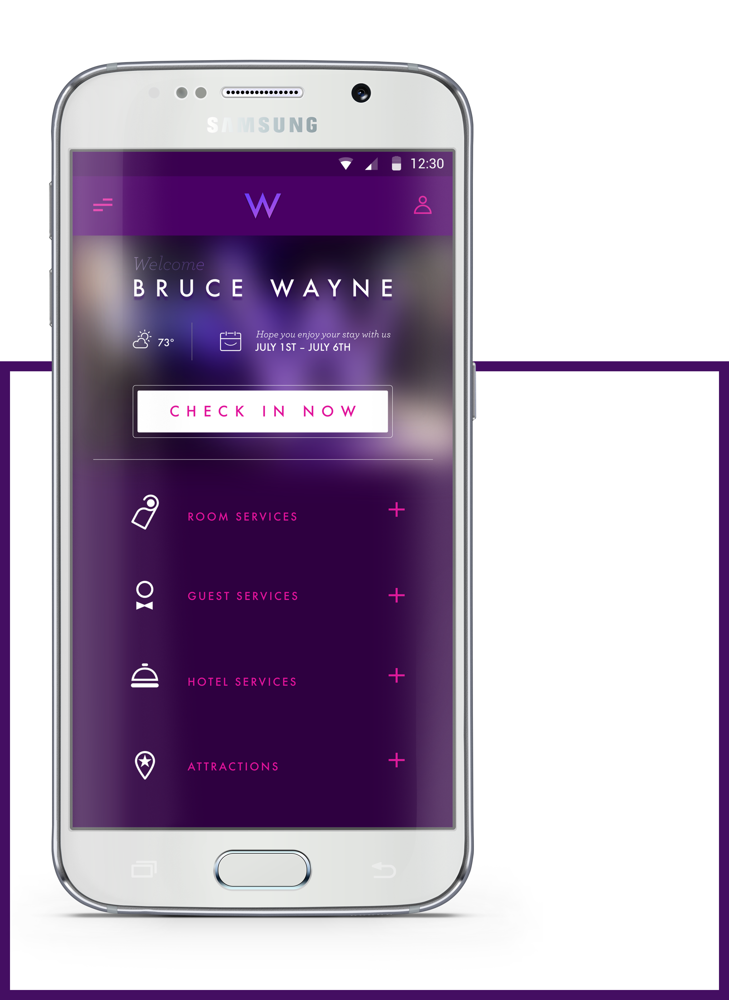
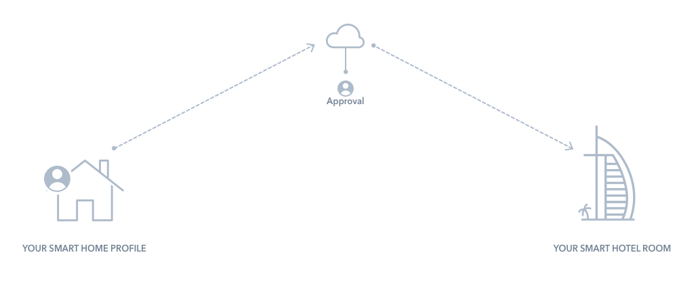
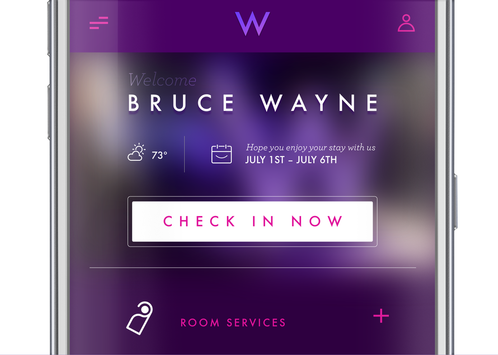
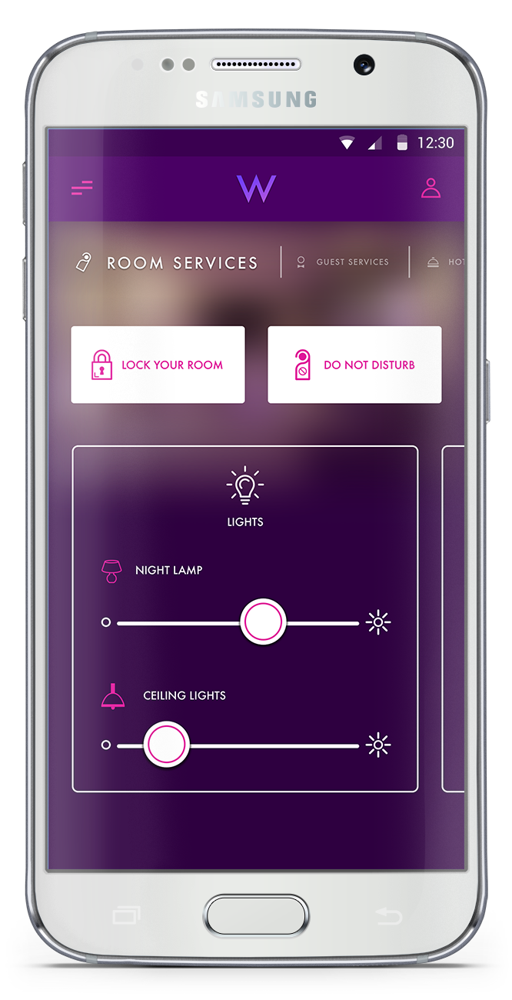
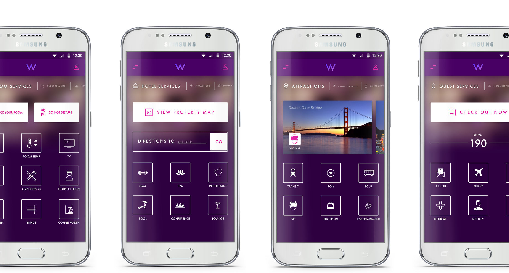
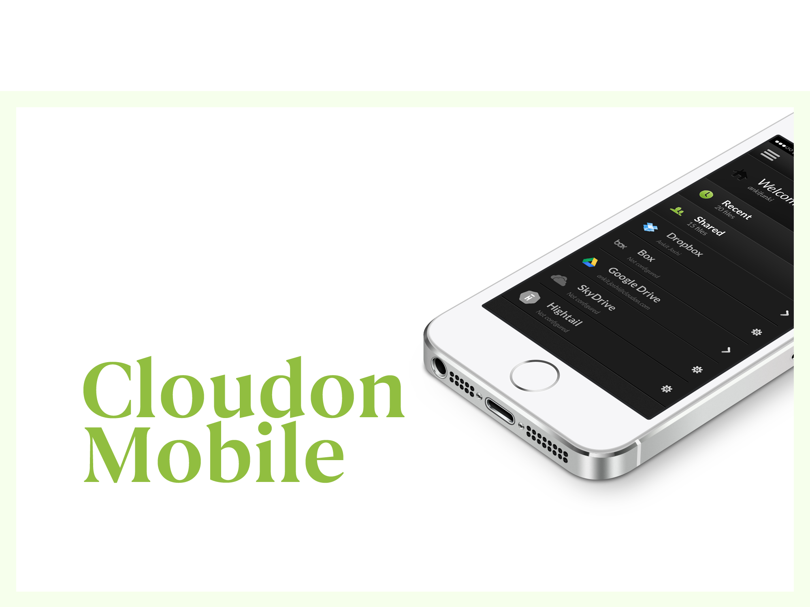
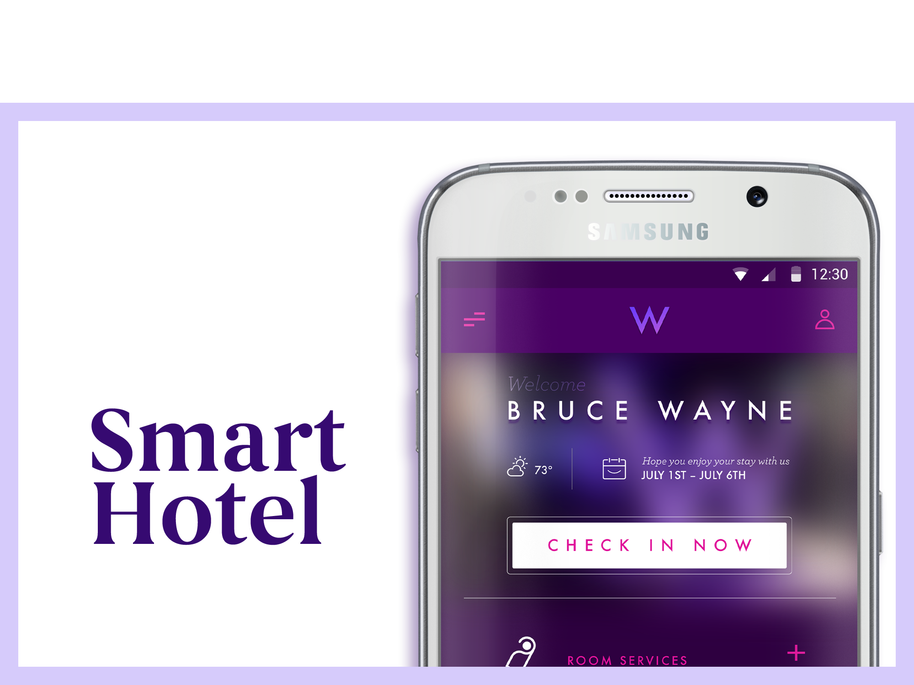

# Smart Hotel

Archived from <https://www.joshiankit.com/work/smart-hotel/> on 2026-10-15 (static HTML, no scripts run).

## Smart Hotel

Just like your home

Concept

Smart Hotel (a project name), was a quick hackathon project that a tiny team of two engineers and myself had came up with at one of the internal 'next-idea' challenge at samsung. This was more of an after hours project and had to be delivered in 2 working days. I picked 'W' hotel since it seems apt for their audience.

Designer
2015

### The Idea was...

Set in the near future, when the dwelling places will be digital connected and controlled. We would create a user profile with all their preferences set in their home, for .e.g lights, temperature, coffee maker, TV etc. This profile will be securely stored in the cloud, which the user has full control over who gets access to it. When a user travels and is staying at a hotel, the hotel would request access to their profile, which the user would approve. Once the user checks-in to the hotel, the room is set to his exact preferences, making it a truly home-away from home experience.

### Welcome

As soon as you enter the hotel, all you have to do is let the hotel know you've arrived and would like begin your stay. Just by tapping on 'Check in now', you're on your way to your room. Wave at check-in desk ??

### Just like home

Once you're in your personalized room, you can control anything you'd like to set it to your liking. All the things in the room are at your fingertips, from dimming the lights to locking the door. Just turn on do not disturb and get some well deserved ?

Related

Work

CloudOn Tablet
____

Recipes
__

Beam
–––

Houzz
--

CloudOn Mobile
____

Concept
—

Smart Hotel
___

CloudOn Web
____

415 244 2442

LinkedIn

Résumé

Dribbble

Twitter

Facebook

Instagram

Related
